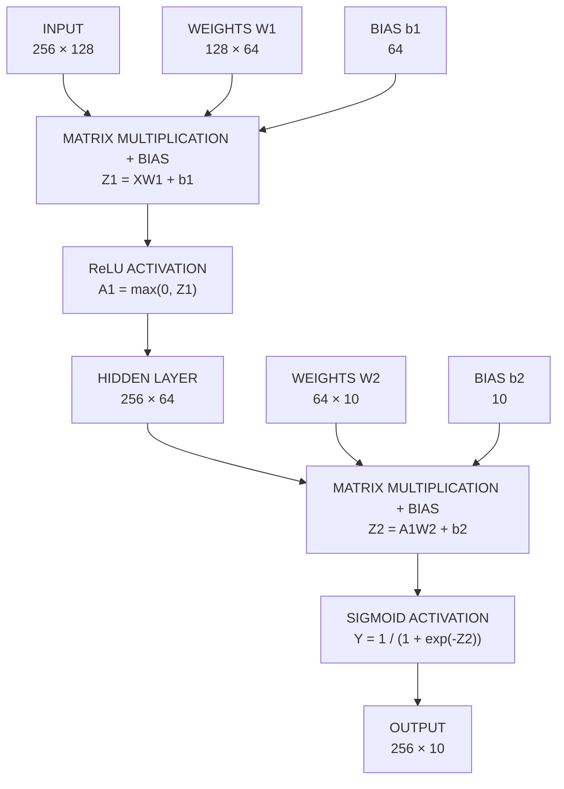
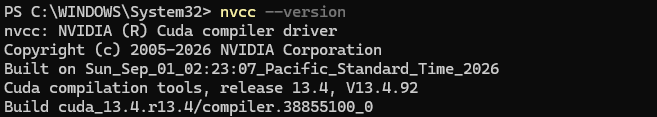
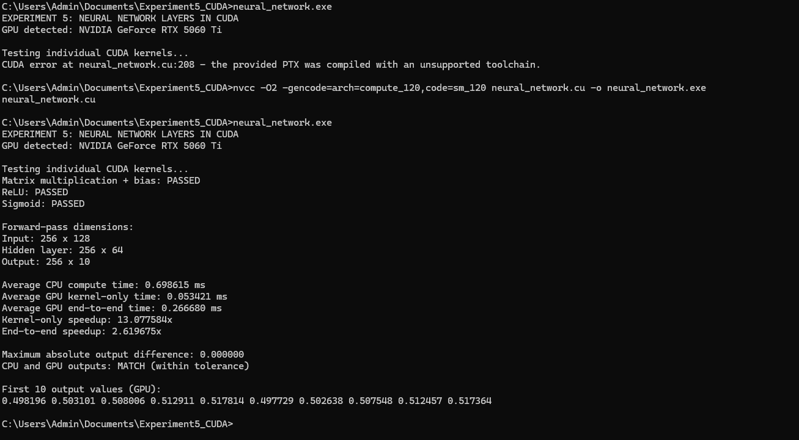

# Experiment 5: Neural Network Layers in CUDA


**Parallel implementation of a two-layer neural network forward pass using custom CUDA kernels**

---

## 1. Aim

To implement basic neural network operations using CUDA and compare their performance on the CPU and GPU.

The experiment implements matrix multiplication with bias addition, ReLU activation, and Sigmoid activation using custom CUDA kernels.

## 2. Neural Network Architecture

The experiment uses a two-layer fully connected neural network with:

- **Input layer:** 128 features
- **Hidden layer:** 64 neurons
- **Output layer:** 10 neurons
- **Batch size:** 256 samples

### Architecture and Data Flow



### Network Operations

| Layer | Operation | Output Dimensions |
|---|---|---:|
| First fully connected layer | Matrix multiplication + bias | 256 × 64 |
| Hidden activation | ReLU | 256 × 64 |
| Second fully connected layer | Matrix multiplication + bias | 256 × 10 |
| Output activation | Sigmoid | 256 × 10 |

## 3. Mathematical Formulation

The network performs forward propagation through two fully connected layers.

**First layer:**

```text
Z₁ = X · W₁ + b₁
```

**ReLU activation:**

```text
A₁ = max(0, Z₁)
```

**Second layer:**

```text
Z₂ = A₁ · W₂ + b₂
```

**Sigmoid activation:**

```text
Y = 1 / (1 + e^(−Z₂))
```

The final output has dimensions **256 × 10**.

| Symbol | Dimensions | Description |
|:---:|:---:|---|
| X | 256 × 128 | Input matrix |
| W₁ | 128 × 64 | First weight matrix |
| b₁ | 64 | First bias vector |
| A₁ | 256 × 64 | Hidden layer output |
| W₂ | 64 × 10 | Second weight matrix |
| b₂ | 10 | Second bias vector |
| Y | 256 × 10 | Final output |

> **Note:** This experiment implements forward propagation only. It does not include training or backpropagation.

## 4. CUDA Implementation

Three CUDA kernels are implemented:

| CUDA Kernel | Function |
|---|---|
| `matrixMulBiasKernel` | Performs matrix multiplication and bias addition |
| `reluKernel` | Applies ReLU activation to matrix elements |
| `sigmoidKernel` | Applies Sigmoid activation to matrix elements |

CUDA threads process independent calculations in parallel. The kernels are executed in sequence to complete the neural network forward pass.

A CPU implementation performs the same operations and serves as the reference for correctness and performance comparison.

## 5. Experimental Environment

| Component | Specification |
|---|---|
| Operating System | Windows 11 |
| Programming Language | CUDA C/C++ |
| CUDA Toolkit | 13.4 |
| CUDA Compiler | NVIDIA NVCC |
| GPU | NVIDIA GeForce RTX 5060 Ti |
| Compute Capability | 12.0 |
| Compiler Optimization | `-O2` |

## 6. Compilation and Execution

Open the **x64 Native Tools Command Prompt for VS 2022** and navigate to the project directory.

**Compile:**

```cmd
nvcc -O2 -gencode=arch=compute_120,code=sm_120 neural_network.cu -o neural_network.exe
```

**Execute:**

```cmd
neural_network.exe
```

The program detects the GPU, tests the CUDA kernels, performs neural network forward propagation, compares CPU and GPU outputs, and displays execution timings.

## 7. Performance Evaluation

The experiment measures CPU execution time and two GPU execution times.

- **CPU Compute Time:** Time taken by the CPU implementation.
- **GPU Kernel-Only Time:** GPU computation time excluding data transfers.
- **GPU End-to-End Time:** GPU execution time including data transfers and computation.

### Experimental Results

| Performance Metric | Result |
|---|---:|
| CPU Compute Time | 0.698615 ms |
| GPU Kernel-Only Time | 0.053421 ms |
| GPU End-to-End Time | 0.266680 ms |

### Speedup Calculation

Speedup is calculated using:

```text
Speedup (S) = CPU Time / GPU Time
```

**Kernel-only speedup:**

```text
S(kernel) = 0.698615 ms / 0.053421 ms ≈ 13.08×
```

**End-to-end speedup:**

```text
S(end-to-end) = 0.698615 ms / 0.266680 ms ≈ 2.62×
```

| Speedup Type | Value |
|---|---:|
| Kernel-only | **13.08×** |
| End-to-end | **2.62×** |

The GPU achieves a higher kernel-only speedup because this measurement excludes data transfer overhead. The end-to-end measurement includes data transfers and therefore gives a lower overall speedup.

## 8. Correctness Verification

Each CUDA kernel is tested independently, and the complete GPU output is compared with the CPU reference.

| Validation Test | Result |
|---|:---:|
| Matrix Multiplication + Bias | PASS |
| ReLU Activation | PASS |
| Sigmoid Activation | PASS |
| CPU and GPU Output Comparison | MATCH |

**Maximum absolute output difference:** `0.000000` (displayed to six decimal places).

The outputs match within the specified numerical tolerance of **10⁻⁴** (0.0001).

## 9. Execution Screenshots

### CUDA Toolkit and Compiler Version



### Neural Network Execution and Results



## 10. Repository Structure

```text
PGC-EXP5-CUDA-Neural-Network-implementation/
│
├── neural_network.cu
├── neural_network.exe
├── cuda_version.png
├── neural_network_execution.png
└── README.md
```

## 11. Conclusion

The experiment successfully implements a two-layer neural network forward pass using custom CUDA kernels.

Matrix multiplication with bias addition, ReLU, and Sigmoid operations were executed and validated against the CPU implementation.

On the NVIDIA GeForce RTX 5060 Ti, the experiment achieved a **13.08× kernel-only speedup** and a **2.62× end-to-end speedup**. All kernel tests passed, and CPU and GPU outputs matched within the specified tolerance.

This experiment demonstrates the benefits of GPU parallelism for neural network computation using CUDA.

---

**Experiment 5 | Neural Network Layers in CUDA | GPU Parallel Computing**
